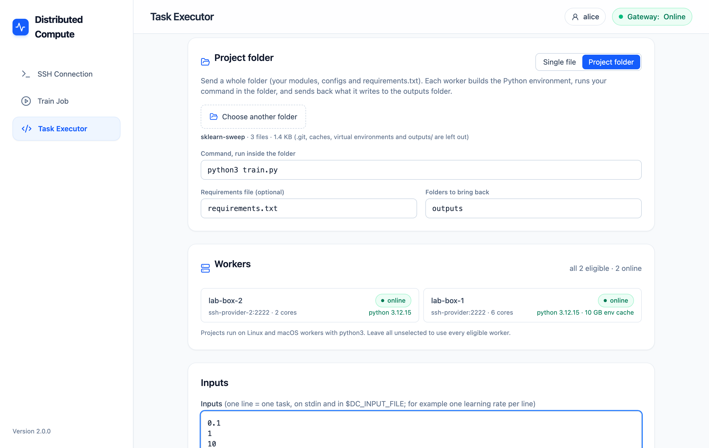
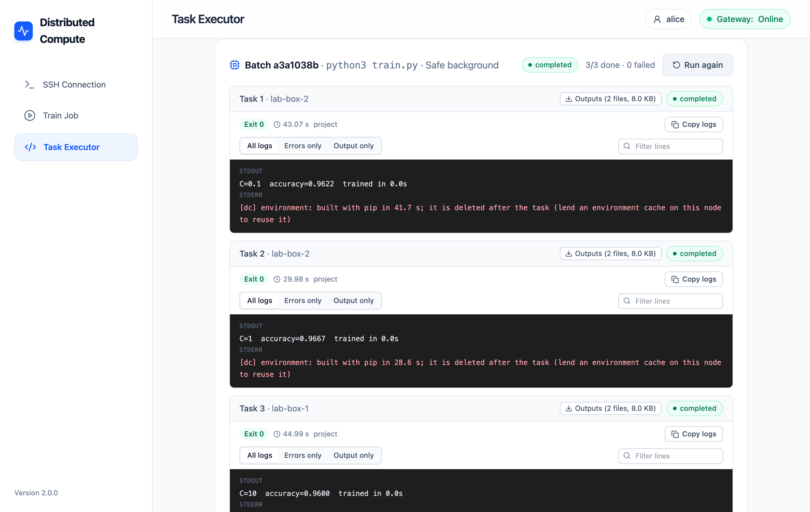
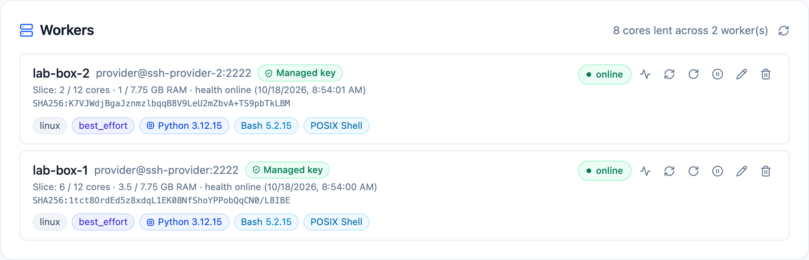
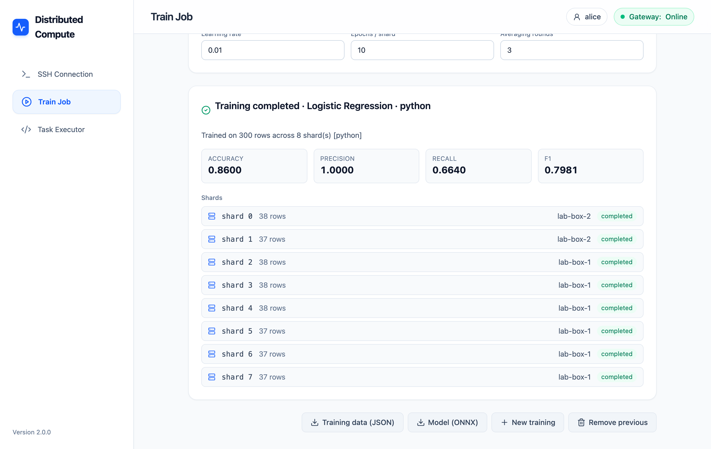
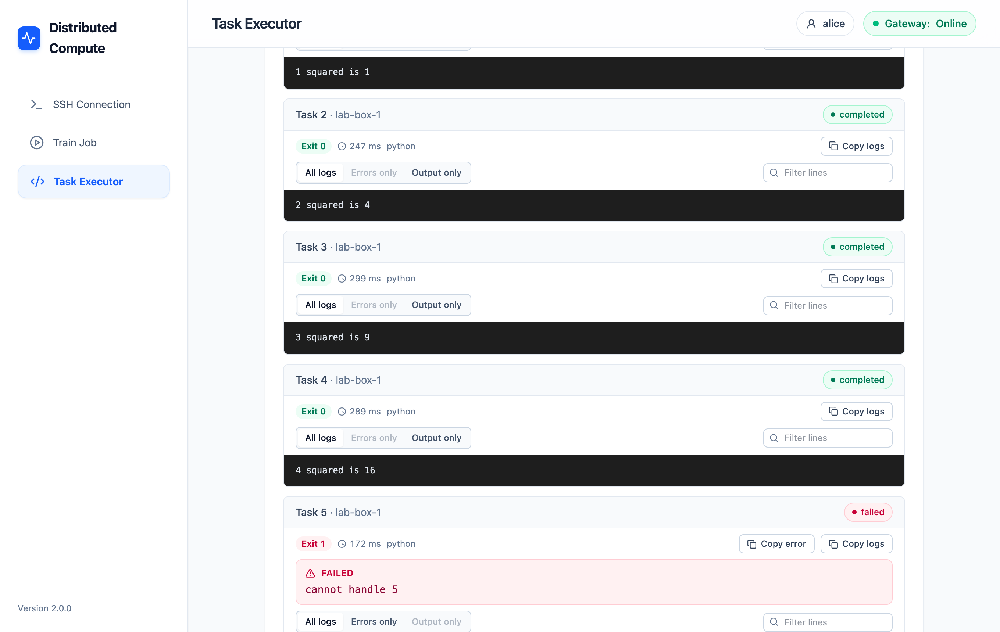
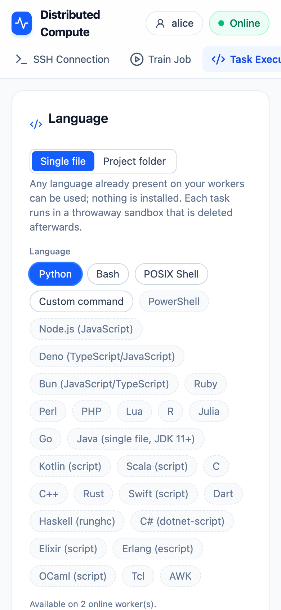
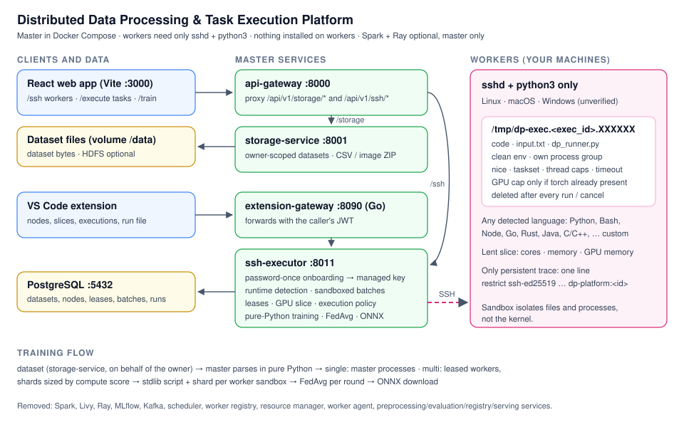

# Distributed Compute

[](https://github.com/lekshmipriya04/Distributed_Compute/actions/workflows/ci.yml)
[](LICENSE)

[](https://marketplace.visualstudio.com/items?itemName=aaron43210.distributed-ai-compute)

**Run your own code and models on the computers you already have, over
plain SSH.** Lend a few cores of a lab machine, an old laptop or a server, then
send a whole project folder (your modules, configs and `requirements.txt`) to
all of them at once, from VS Code, the web dashboard or the `dc` command line.
Each worker builds the Python environment, runs your command, and sends back
what it wrote to `outputs/`.

Workers need only `sshd` and `python3`. **Nothing is installed on them.** You
type a worker's password once; the platform installs a restricted key, forgets
the password, and removes the key when you remove the worker.


## What's new in 2.0

| | 1.x | 2.0 |
|---|---|---|
| What you can run | one file at a time | **a whole folder**: your modules, configs and data files |
| Python packages | only what each worker already had | **`requirements.txt` installed on each worker** (pip, or uv when present), optionally cached |
| Results | the text each task printed | **files too**: everything a task writes to `outputs/` comes back, per task |
| Data | training datasets only | **datasets copied into the project** for any code (`$DC_DATA_DIR`) |
| Where from | VS Code and the dashboard | VS Code, the dashboard, and the **`dc` command line** |
| Dataset storage | HDFS: 10 containers, 1.9 GB of memory | **plain files**: 6 containers, 0.5 GB (HDFS optional) |
| Start, until the first upload works | 33 s | 23 s |

The built-in models (linear and logistic regression, a small CNN) are still
there as demos. The point of 2.0 is that **your own model runs as it is**:
PyTorch, scikit-learn, Hugging Face, or anything else that installs with pip.

## Run your own project (new in 2.0)

1. Put a `requirements.txt` next to your code, and have it write results to
   `outputs/` (or `$DC_OUTPUT_DIR`).
2. Run it on your workers, one task per input (for example one learning rate
   per task):
   - **VS Code:** right-click the folder → **Run Project on Workers…**
   - **Dashboard:** Task Executor → **Project folder** → choose the folder
   - **Terminal:** `dc run -i 0.1 -i 0.01 -- python train.py`
3. Each worker unpacks the folder, builds the environment and runs your
   command. You see every task's output live.
4. Download each task's `outputs/`: **Download Project Outputs** in VS Code,
   the **Outputs** button on the dashboard, or `dc pull <run id>`.

| | |
|---|---|
|  |  |
| A scikit-learn project, one task per value of C | Each task's output, and its files to download |

Ready-made examples in [`examples/`](distributed-ai-platform/examples):
[hello-project](distributed-ai-platform/examples/hello-project) (no
packages), [sklearn-sweep](distributed-ai-platform/examples/sklearn-sweep) and
[pytorch-train](distributed-ai-platform/examples/pytorch-train) (uses the GPU
a worker lends). The command line is in
[`clients/cli`](distributed-ai-platform/clients/cli): `pip install ./clients/cli`.

**Environments.** By default a task builds its environment inside its sandbox,
and it is deleted afterwards: nothing stays on the worker. A worker's owner can
lend disk for an **environment cache** (VS Code: **Set Environment Cache…**,
dashboard: the worker's edit form, `dc cache <node> 20`). Then the environment
is built once per worker and reused; in our test a scikit-learn task went from
46 s to 1.2 s. The cache lives in `~/.cache/distributed-compute` and is
deleted when the worker is removed.

## What you can do

- **Add workers** with their SSH password, once. The platform shows the host
  key to confirm, detects CPU, memory, GPU and languages, and lets you choose
  how much of each machine to lend.
- **Run project folders** (above), or a single file **in any language** your workers have (Python, Bash, Node.js, Go,
  Rust, Java, C/C++, Ruby, R, Julia, … or any command you give), as many
  parallel tasks, each in a throwaway sandbox. Watch every task's output live,
  cancel, retry only the failed tasks, and copy the output (VS Code can also
  save every task's output to files).
- **Train with the built-in trainer** across your workers (demos: linear and
  logistic regression and a small CNN), a `model.py` that the master averages
  across workers (federated averaging), or, with the optional Spark + Ray
  engine, **any Spark MLlib model**. Download the trained model (ONNX, JSON or
  a Spark pipeline).
- **Share it** with a team: each person signs in with their own token and sees
  only their own workers, runs and data.

| | |
|---|---|
|  |  |
| The dashboard: workers with their slice, health and languages | A model trained across two workers |
|  |  |
| Each task's output, failures pulled out | On a phone |

## Quick start

You need [Docker](https://www.docker.com/products/docker-desktop/) (Docker
Desktop on Windows and macOS, Docker Engine or Desktop on Linux).

**From VS Code, with no terminal:** install the
[**Distributed AI Compute** extension](https://marketplace.visualstudio.com/items?itemName=aaron43210.distributed-ai-compute)
and click **Set Up Now** when it asks. It starts Docker if needed,
downloads the platform, starts it and connects. Then click **Add Compute
Node**.

**From a terminal:**

```bash
git clone https://github.com/lekshmipriya04/Distributed_Compute.git
cd Distributed_Compute/distributed-ai-platform
make up          # first start builds the images: several minutes
```

Open the dashboard at **http://localhost:3001**, go to **SSH Connection** and
add a worker. The [dashboard guide](distributed-ai-platform/frontend/README.md)
and the [extension guide](distributed-ai-platform/distributed-compute-vscode/README.md)
walk through every step with screenshots. Because the platform runs inside Docker:

| Worker | Address to enter |
|---|---|
| This computer | `host.docker.internal` (turn on SSH / Remote Login first) |
| Another machine on your network | its IP address, e.g. `192.168.1.20` |
| Two test workers, to try it out | run `make up-dev`, then `ssh-provider` (and `ssh-provider-2`), port `2222`, user `provider`, password `providerpass`. They are small Debian machines with Python 3.12, like a typical Linux PC |

Use a dedicated, non-admin account on each worker: tasks run with its
permissions.

`make down` stops everything and keeps your data; `make reset` deletes it.
`make backup` copies the database and datasets to `backups/<date>/`.

**Upgrading from 1.x?** Run `make up`, then `make migrate-datasets` to move
datasets out of HDFS. See [Upgrade from 1.x](distributed-ai-platform/docs/DEPLOYMENT.md#6-upgrade-from-1x-and-rollback).

## One computer, or a team

By default the platform is for **one person on one computer**: every port
listens on `127.0.0.1`, and you are the local user with no sign-in.

For **several people**, run it on one machine in production mode with HTTPS in
front, and give each person a token (`python generate_token.py --sub <name>`).
They sign in from the dashboard's account button or VS Code's **Configure
Authentication**. Each user sees only their own workers, runs, datasets and
models. Step-by-step: [docs/DEPLOYMENT.md](distributed-ai-platform/docs/DEPLOYMENT.md).

## Supported platforms

| | Supported | Tested |
|---|---|---|
| Platform (Docker) | Linux, macOS, Windows | macOS; CI runs it on Linux |
| VS Code extension | VS Code 1.90+ on Linux, macOS, Windows | real VS Code on macOS; CI runs Linux, macOS, Windows |
| Web dashboard | Chrome, Edge, Firefox, Safari; Android and iOS browsers | Chromium, Firefox, WebKit, Android and iPhone emulation (Playwright) |
| Workers | Linux and macOS with `sshd` + `python3`; Windows with OpenSSH | Linux; Windows workers not yet verified |

## How it works

```
VS Code extension ─► extension-gateway :8090 ─┐
Web dashboard :3001 ─► api-gateway :8000 ─────┼─► ssh-executor (the master) ──SSH──► your workers
                                              └─► storage-service ─► datasets volume
```



- **Onboarding.** The master shows the worker's host-key fingerprint before
  any credential is sent. Your password is used once to install a
  `restrict ssh-ed25519 … dp-platform:<id>` key, then dropped. If a worker
  refuses password logins, you get one command to run there instead.
- **Projects.** The folder is packed into a `.tar.gz` (`.git`, caches,
  virtual environments and `outputs/` are left out; in a git repository
  `.gitignore` applies) and uploaded once: it is stored under its hash, so an
  unchanged folder is never sent again. For each task the master copies it and
  any datasets into the sandbox, a small standard-library helper unpacks it
  and builds the environment (`python3 -m venv` + pip, or uv), the command runs
  like any task, and the output folders are packed and brought back before the
  sandbox is deleted. A broken `requirements.txt` fails the task with pip's
  message; it is not retried on other workers.
- **Tasks.** Each task runs in its own temporary directory on the worker, with
  a clean environment, its own process group, `nice`, core pinning (Linux) and
  a timeout. Afterwards the processes are killed and the directory deleted:
  on success, failure, timeout or cancel.
- **Resources.** Cores and memory are reserved per worker so jobs never
  overcommit it. A GPU slice is enforced for Python tasks where PyTorch is
  already installed.
- **Training.** The master splits the dataset into shards sized by each
  worker's speed, sends each worker its shard and a small script (or your
  `model.py`), and averages the results over several rounds (federated
  averaging).
- **Datasets.** Files live in the Docker volume `datasets`; names, owners and
  sizes in Postgres. Uploads and downloads are streamed, so file size does not
  affect memory. Installs that already run HDFS can keep using it with
  `make up-hdfs` (adds 4 containers and about 1.4 GB of memory).
- **Spark + Ray (optional).** `make enable-spark-ray`, or **Enable Spark + Ray
  Engine** in VS Code, adds about 1 GB to the master (never to workers): every
  Spark MLlib model with grid search, Parquet data, and Ray for the parameter
  server and parallel local shards. Existing clusters can be used via
  `SPARK_MASTER_URL` and `RAY_ADDRESS`.

**Step-by-step guides with screenshots:**
[VS Code extension](distributed-ai-platform/distributed-compute-vscode/README.md) ·
[web dashboard](distributed-ai-platform/frontend/README.md)

More: [architecture](distributed-ai-platform/docs/architecture.md) ·
[ports and protocols](distributed-ai-platform/docs/connections.md) ·
[API](distributed-ai-platform/docs/API_CONTRACT.md) ·
[project overview](distributed-ai-platform/project.md)

## Development and tests

```bash
cd distributed-ai-platform
make init && pytest tests -q && make lint            # Python services
(cd services/extension-gateway && go test ./...)     # Go gateway
(cd frontend && npm ci && npm test && npm run build) # dashboard
(cd distributed-compute-vscode && npm ci && npm test && npm run test:vscode)
```

The `dc` command line is tested with the Python tests (`tests/unit/clients`).

End-to-end tests run against the real stack (`make up-dev`) as three users on
three ports:

```bash
(cd frontend && npm run e2e:serve && npm run test:e2e)  # Chromium, Firefox, WebKit, Android, iOS
(cd distributed-compute-vscode && npm run test:e2e)     # needs gateways on 8091/8092, see the CI e2e job
```

For dashboard development with hot reload: `cd frontend && npm run dev`
(http://localhost:3000).

## Limits

- The sandbox isolates **files and processes, not the kernel**. Tasks can read
  the SSH user's files and use the network; that is why workers need a
  dedicated, non-admin account. A task that deliberately escapes its process
  group can outlive the job.
- Memory slices are a scheduling figure, not a kernel limit; cores are not
  pinned on macOS. The GPU cap is best effort and needs PyTorch on the worker.
- End-to-end tests use Docker test workers. **Physical remote machines and
  Windows workers have not been verified yet.** Projects run on Linux and
  macOS workers; Windows workers can run single files only.
- A task can run for at most an hour (`max_task_timeout_seconds`), and a job
  that is running when the master restarts is stopped. Multi-machine training
  frameworks (`torchrun`, DeepSpeed) are not launched across workers yet:
  each task is independent.
- Packages that need a compiler fail to install on workers that have none and
  for which the package publishes no ready-made wheel (for example
  scikit-learn on Alpine Linux with Python 3.14); the task shows pip's error.
- `ssh-executor` runs code you send on your workers: treat it as a privileged
  service. Put HTTPS in front of it when anyone else can reach it.
- Database changes are additive only; `make migrate-datasets` is the only
  data migration so far.

## Contributing

Contributions are welcome: see [CONTRIBUTING.md](CONTRIBUTING.md). Please read
the [Code of Conduct](CODE_OF_CONDUCT.md), and report security issues
privately as described in [SECURITY.md](SECURITY.md).

## Repository layout

```text
distributed-ai-platform/
├── docker-compose.yml, Makefile, generate_token.py
├── config/                      .env.example (settings and secrets)
├── frontend/                    web dashboard (React, Vite, nginx) + Playwright tests
├── distributed-compute-vscode/  VS Code extension
├── clients/cli/                 the `dc` command line (Python, standard library only)
├── examples/                    projects to try: hello-project, sklearn-sweep, pytorch-train
├── services/                    api-gateway, storage-service, ssh-executor (Python), extension-gateway (Go)
├── shared/                      shared Python library
├── infrastructure/docker/       Postgres init, test worker image, Hadoop config (optional HDFS)
├── docs/                        architecture, API, deployment, images
└── tests/                       Python unit tests, load test
```

## Authors and license

Made by AARON R, M R LEKSHMI PRIYA and ALEENA VJ. Released under the
[MIT License](LICENSE).
