# Distributed AI Compute for VS Code

**Run your code and your own models on the computers you already have, from
VS Code.** Lend a few cores of a lab machine, an old laptop or a server, then
run any file, or a whole project folder with its `requirements.txt`, on all of
them in parallel and watch every task's output live. No terminal or browser
needed.

Workers need only `sshd` and `python3`; **nothing is installed on them.** You
type a worker's password once: the platform installs a restricted key and
forgets the password.

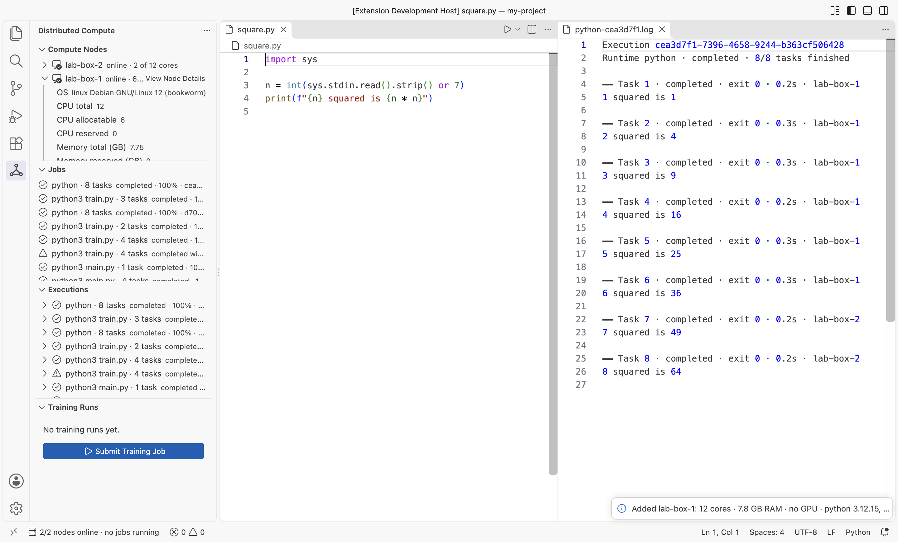

- [What you need](#what-you-need)
- [1. Start the platform](#1-start-the-platform)
- [2. Add a worker](#2-add-a-worker)
- [3. Run code in parallel](#3-run-code-in-parallel)
- [4. Run your own project (new in 1.0.1)](#4-run-your-own-project-new-in-101)
- [5. Train with the built-in trainer](#5-train-with-the-built-in-trainer)
- [Use it well](#use-it-well) · [All commands](#all-commands) · [Settings](#settings)
- [Teams and remote masters](#teams-and-remote-masters) · [Troubleshooting](#troubleshooting) · [Security and privacy](#security-and-privacy)

## What you need

- **VS Code 1.90 or newer**, on Windows, macOS or Linux.
- **[Docker Desktop](https://www.docker.com/products/docker-desktop/)** (on
  Linux, Docker Engine works too). The platform runs in Docker on your
  computer; it needs about 2 GB of memory.
- **Git**, only if the extension has to download the platform for you.
- At least one **worker**: any machine you can reach over SSH with `python3`
  (Linux or macOS; Windows with OpenSSH). It can be this computer.

## 1. Start the platform

After you install the extension, it asks whether to run the platform on this
computer. Click **Set Up Now**. You can also click **Set Up Platform on This
Computer** in the Distributed Compute view (the new icon in the Activity Bar).

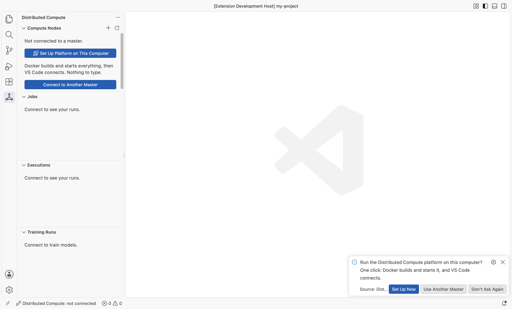

That one click:

1. checks Docker, and starts Docker Desktop if it is closed;
2. downloads the platform (once), or uses the copy in your workspace;
3. creates its settings with safe local defaults;
4. builds and starts it. **The first time takes several minutes**; later starts
   take seconds;
5. connects VS Code. There is nothing to type and no token to paste.

From then on, opening VS Code starts the platform and connects by itself. The
status bar shows how many workers are online; click it for quick actions.

The **Get Started** walkthrough (Welcome page → *Get Started with Distributed
Compute*) shows the same steps:

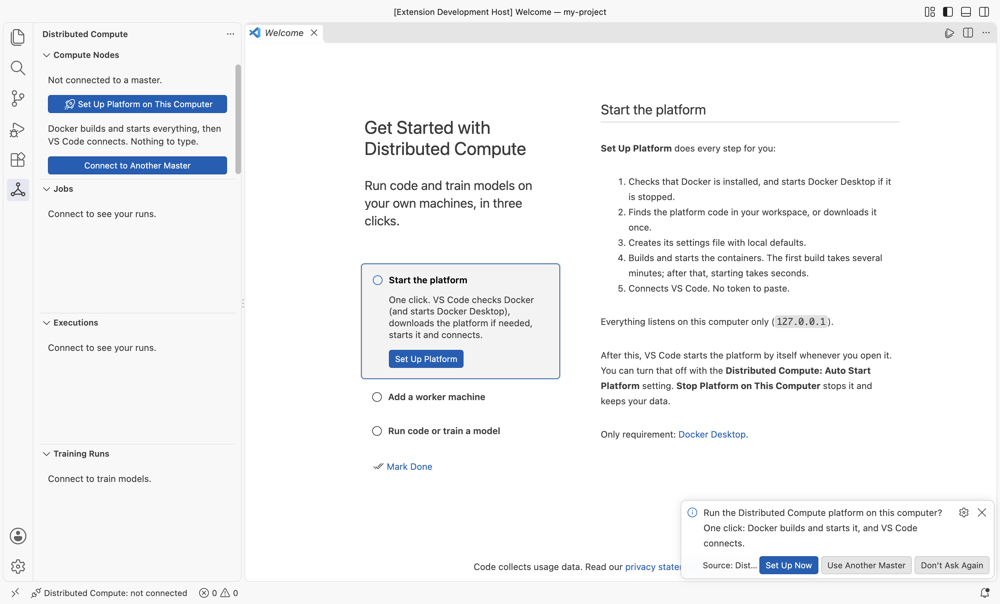

## 2. Add a worker

Click **Add Compute Node** (the **+** in Compute Nodes). Four short questions:

**Address, port and user.** The platform runs in Docker, so use addresses as
Docker sees them:

| Worker | Address |
|---|---|
| This computer | `host.docker.internal` (turn on SSH / Remote Login first) |
| Another machine on your network | its IP address, e.g. `192.168.1.20` |
| The two test workers (`make up-dev`) | `ssh-provider` and `ssh-provider-2`, port `2222`, user `provider`, password `providerpass` |

Do not use `localhost`: inside Docker it means the platform's own container.
The extension warns you if you try. Use a dedicated, non-admin account on the
worker: your tasks run with its permissions.

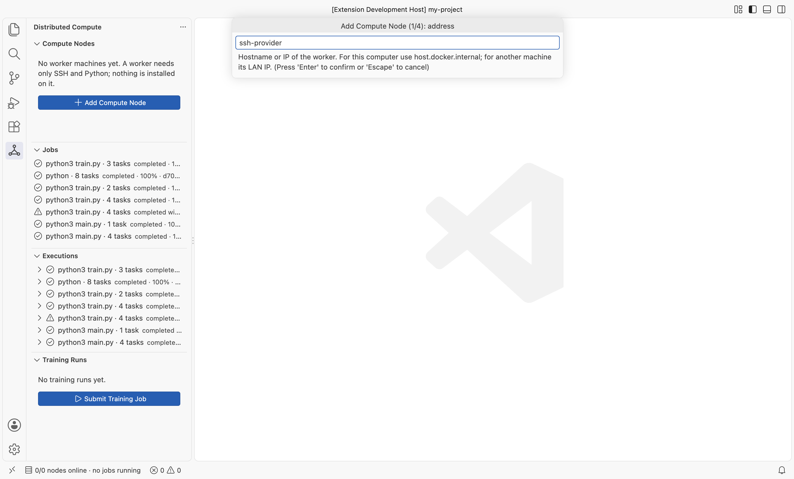

**Trust the machine.** Before any password is sent, you see the worker's host
key. If you are unsure, compare it with `ssh-keygen -lf
/etc/ssh/ssh_host_*_key.pub` on the worker.

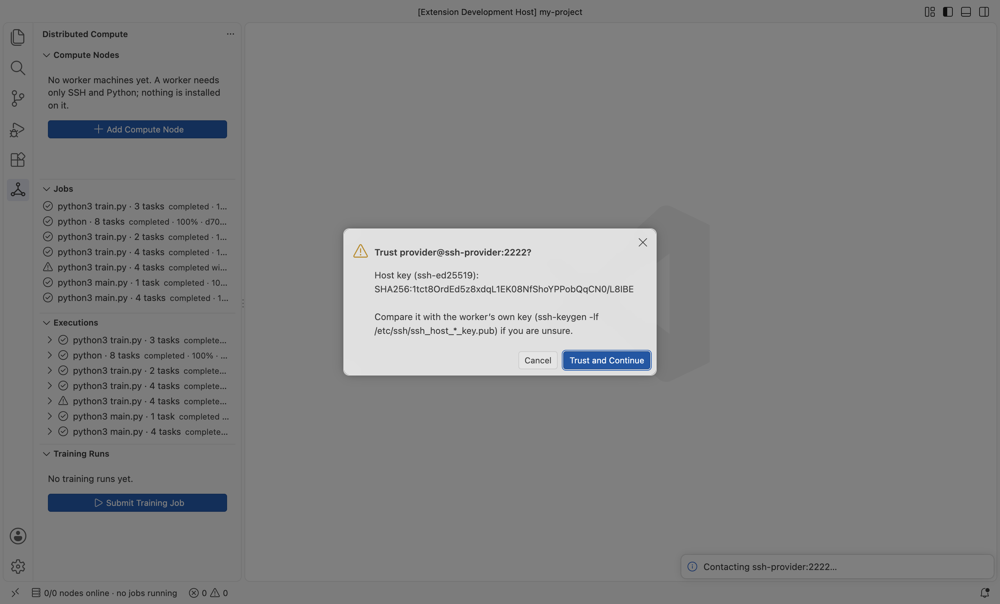

**Password, once.** It is used to install the platform's restricted key and
is then forgotten. If the worker refuses password logins, leave it empty: you
get a one-line command to run on the worker instead.

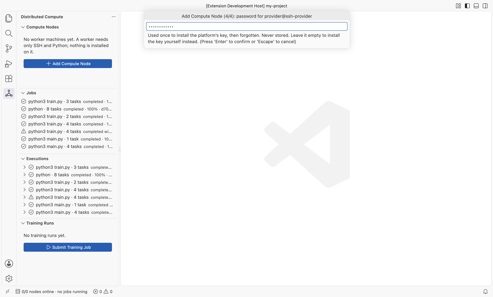

**How much to lend.** The extension shows what it detected (cores, memory, GPU,
languages) and lets you choose a slice. "Half the machine" is a good start;
you can change it later.

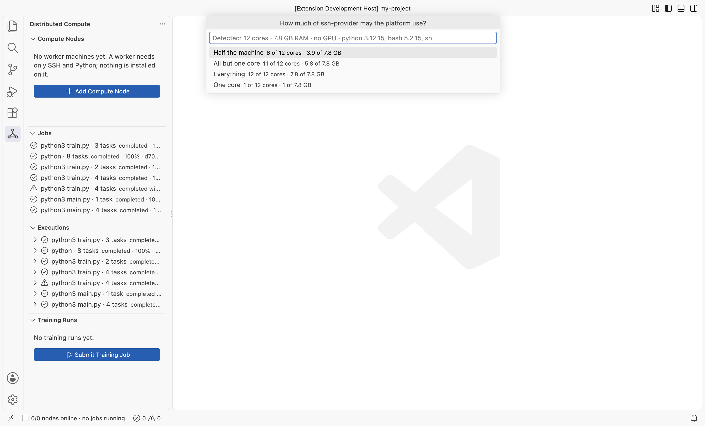

The worker appears in **Compute Nodes**. Expand it to see its details:

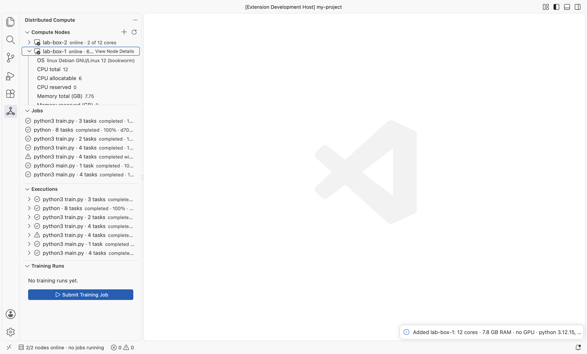

Right-click a worker to **Test Node Connection**, **Detect Node Hardware
Again** (after installing a new language), **Configure Resource Slice**,
**Rotate Node Key**, **Drain Node** (finish running work, take no new work)
and **Resume Node**, or **Remove Node** (its key is deleted from the worker).
The same actions are in the Command Palette:

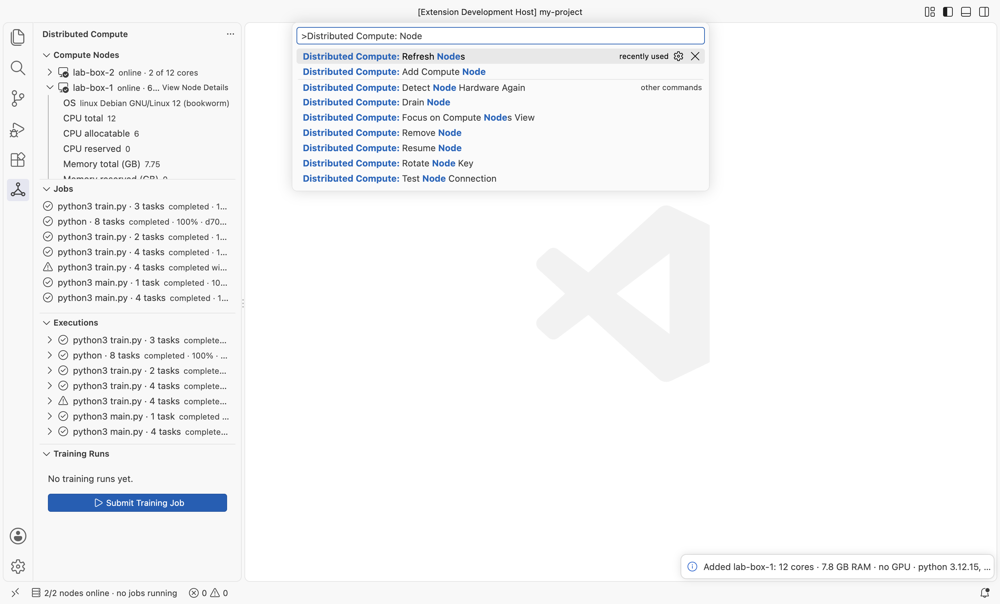

## 3. Run code in parallel

Open any file and use the **Run** button at the top right of the editor:

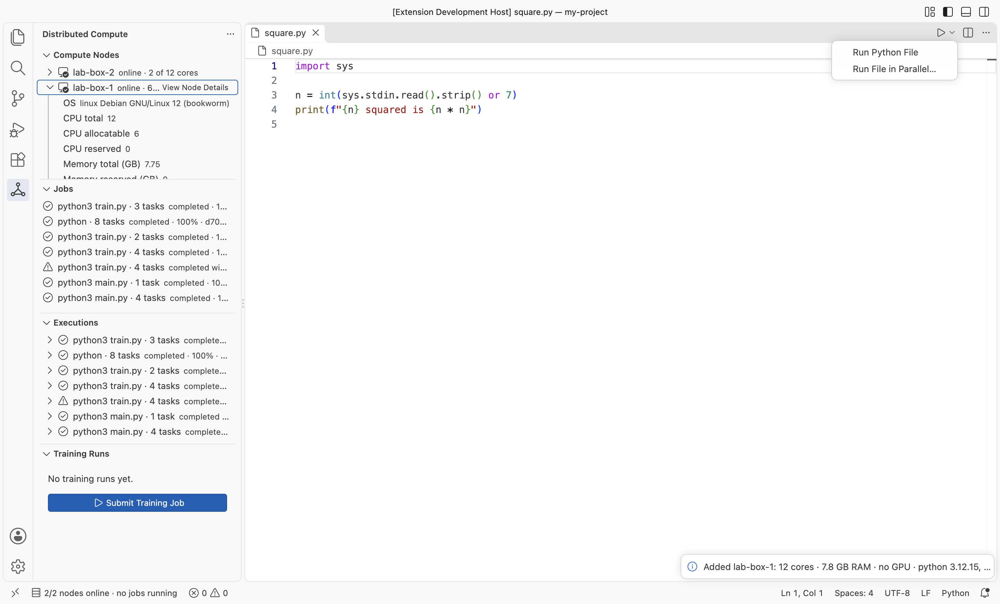

- **Run Python File** runs the file once, on a free worker.
- **Run File in Parallel…** runs it as many tasks at once. Four questions:

**Language**, from those found on your workers (the file's own language is
first). **Custom command** runs anything else, e.g. `zig run {file}`.

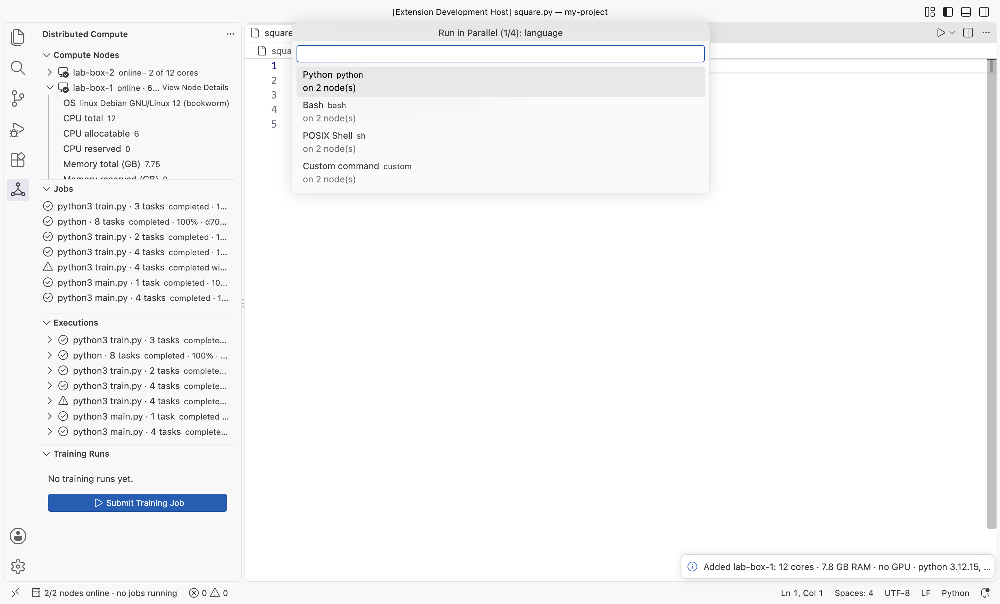

**Tasks.** Each task gets one input on standard input (and as `input.txt`):
type a comma-separated list, use one line of a file per task, or run the same
program N times (each copy gets its number).

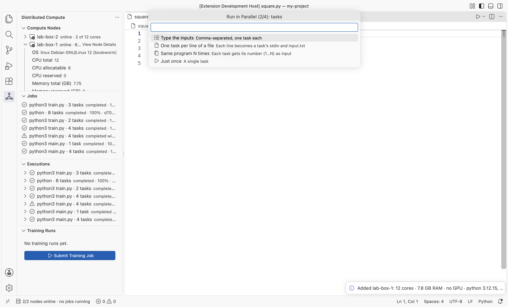

**Workers** (all eligible ones are selected) and **cores per task**:

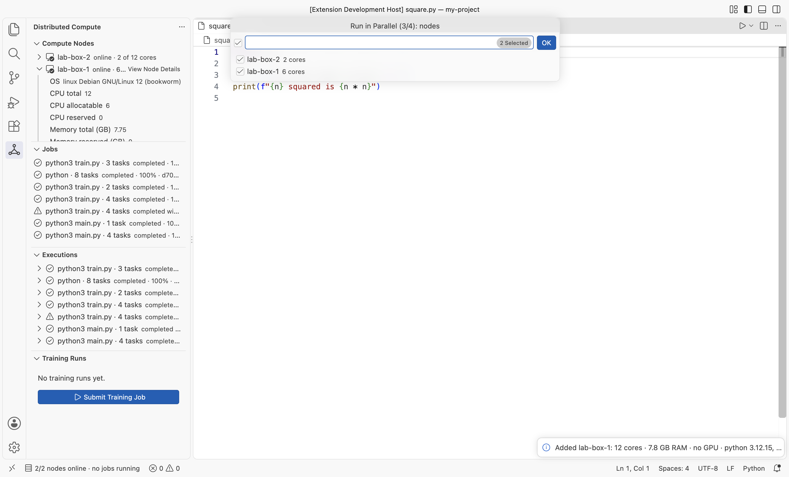

The output opens beside your code and fills in task by task until the run
finishes. Each task shows its status, exit code, time and which worker ran it;
errors appear under `stderr`. The **Jobs** and **Executions** views list your
runs; click one to open its output again.


Right-click a run to **Cancel Execution**, **Retry Execution** (every task, or
only the ones that failed) or **Save Execution Results** (one file per task in
`distributed-results/<id>/`, plus a `summary.json`):

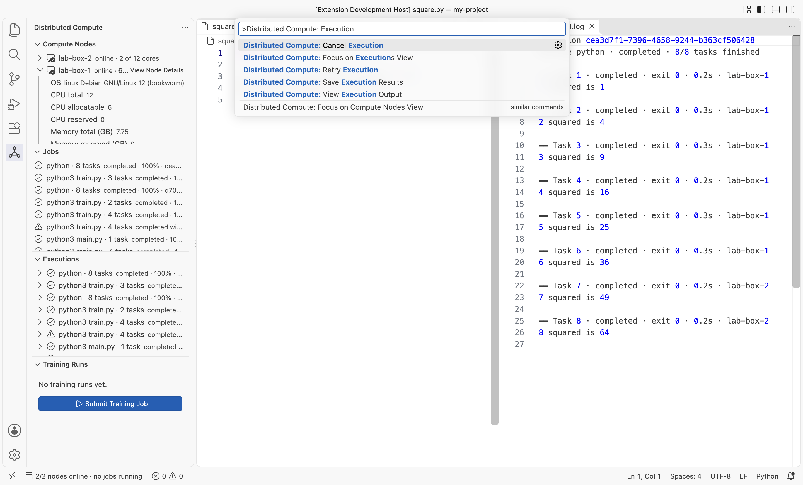

## 4. Run your own project (new in 1.0.1)

For real work your code is more than one file: modules, configs, a
`requirements.txt`. **Run Project on Workers…** sends the whole folder.

1. Right-click the folder in the Explorer → **Run Project on Workers…**, or run
   it from the Command Palette (it uses the workspace folder).
2. Enter the **command** to run inside the folder. It is guessed from your
   files (`python3 train.py` here), and skipped when `distributed.json` has a
   `project` block (below).

   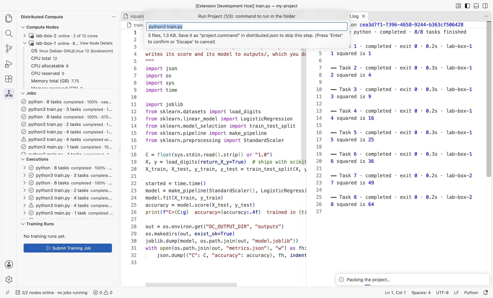

3. Choose the **tasks** (one input per task: here one value of C per task)
   and the **workers**. Projects run on Linux and macOS workers with Python 3.

The folder is packed without `.git`, caches, virtual environments and
`outputs/` (in a git repository `.gitignore` applies too), and uploaded once:
if nothing changed since the last run, it is not sent again. On each worker
the requirements are installed and your command runs inside the folder. The
output opens beside your code as for any run, with a line saying how the
environment was built:

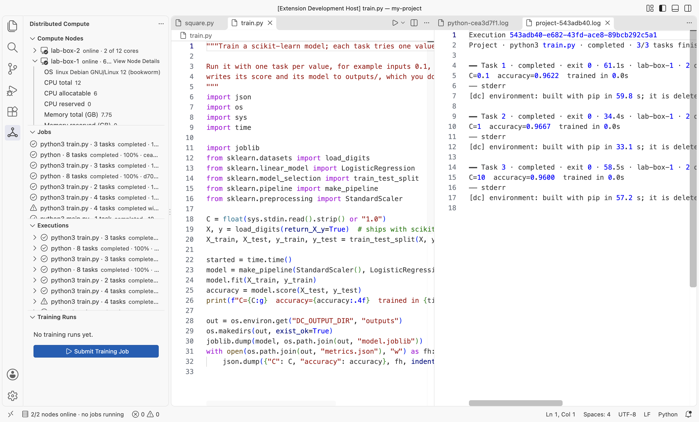

Whatever a task writes to `outputs/` (`$DC_OUTPUT_DIR`) comes back. Run
**Download Project Outputs** (or the download icon on the run) to unpack every
task's files into `distributed-results/<run>/task-001/…`:

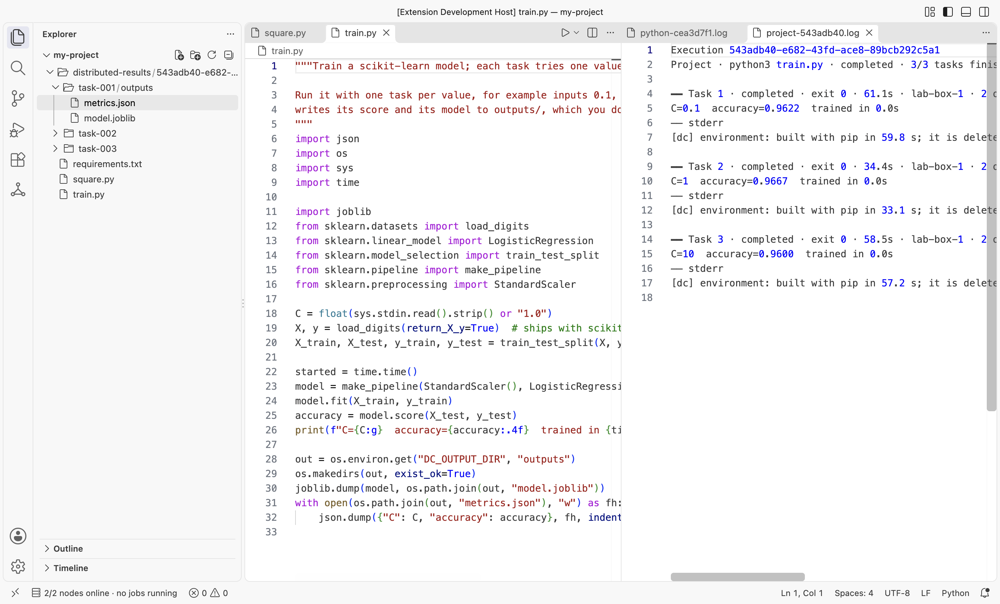

Inside a task you have: its input on standard input and in `$DC_INPUT_FILE`,
`$DC_TASK_INDEX` and `$DC_TASK_COUNT`, `$DC_OUTPUT_DIR`, and `$DC_DATA_DIR`
for datasets listed in `distributed.json`.

**Save the settings in `distributed.json`**, so a run asks only for the tasks
and workers:

```json
{
  "version": 1,
  "name": "my-project",
  "project": {
    "command": "python train.py --epochs 3",
    "requirements": "requirements.txt",
    "outputs": ["outputs"],
    "exclude": ["data/raw/", "*.ckpt"],
    "datasets": [{ "dataset": "<dataset id>", "path": "data/train.csv" }]
  }
}
```

**Environment cache.** By default each task builds its environment in its
sandbox and it is deleted afterwards. Right-click a worker → **Set Environment
Cache…** to let it keep environments (in `~/.cache/distributed-compute`, up to
the size you choose); later tasks with the same requirements then start in
about a second instead of rebuilding. The cache is deleted when you remove the
worker.

## 5. Train with the built-in trainer

Run **Submit Training Job** (also in the Training Runs view, or right-click a
`.csv`, `.json` or `.parquet` file → **Train on This Dataset**).

**Dataset**: pick one you uploaded before, or upload a file.

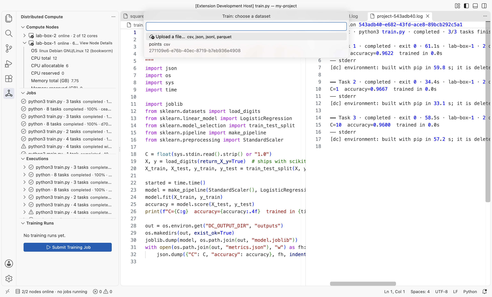

**Engine**: Pure Python needs nothing. Spark + Ray is optional (see below).

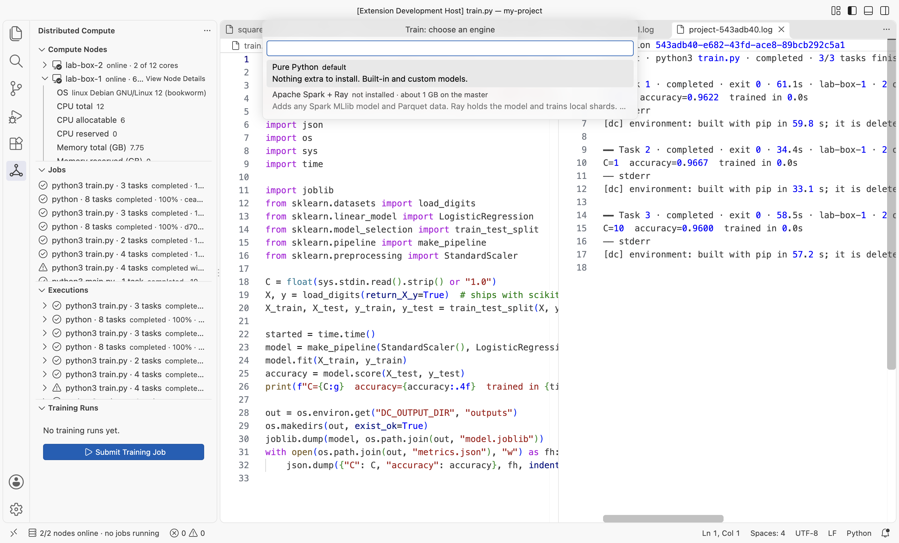

**Model**: linear or logistic regression, a small CNN for image datasets, or
**your own `model.py`**. Then choose the column to predict, where to train
(your workers, or the master's own cores), and rounds and epochs.

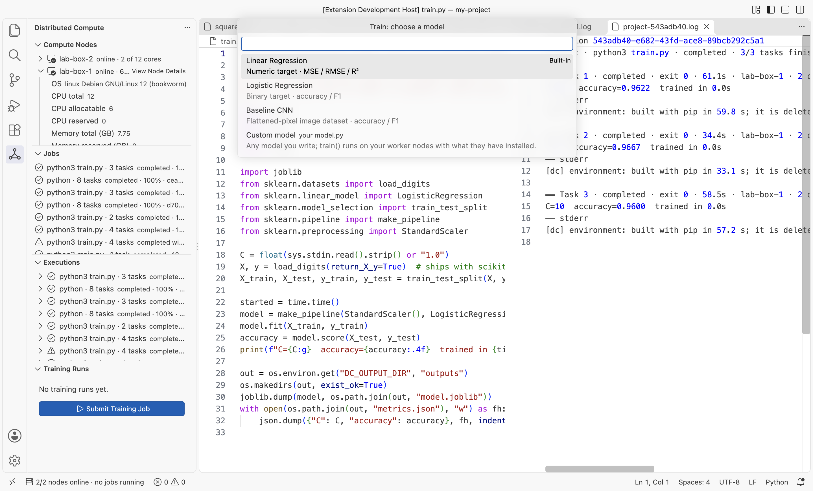

The master splits the data into shards sized by each worker's speed, trains on
every worker, and averages the results over several rounds. **Training Runs**
shows progress, then accuracy or error metrics. Click the download icon to
save the model (ONNX for built-in models, JSON for your own, a zip for Spark).

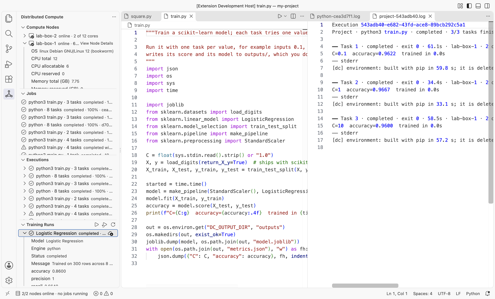

**Your own model.** **New Custom Model File** writes a starter `model.py` with
`init`, `train` and `evaluate`. Use any library your workers already have
(numpy, torch, …); nothing is installed for you. Then right-click it →
**Train with This Model File**.

**Spark + Ray (optional).** **Enable Spark + Ray Engine** adds every Spark
MLlib model (random forests, gradient boosting, k-means, …) with grid search,
and Parquet data. It is installed on the master only (about 1 GB), never on
workers.

**Repeat a run.** When a training starts, click **Save for Run Again** in its
notification (the settings go into `distributed.json`); from then on **Run
Training Again** repeats it in one click.

## Use it well

- **Split work into many small tasks.** A task per input file, per parameter
  value or per chunk of data lets every core work at once. Many more tasks than
  cores is fine: they queue and start as cores free up.
- **Cores per task.** Use 1 for single-threaded scripts; more only if your code
  uses several threads or processes.
- **Make tasks independent.** Each task runs in its own temporary directory,
  deleted afterwards. Print your results, or in a project write files to
  `outputs/` and use **Download Project Outputs**.
- **Retry only what failed.** After a partly failed run, **Retry Execution** →
  *only the failed tasks* runs just those inputs again.
- **Drain before maintenance.** **Drain Node** lets running tasks finish and
  sends nothing new; **Resume Node** brings the worker back.
- **Lend what you can spare.** Slices are reserved, so jobs never overload a
  worker. On a computer you also use, lend half and keep the default "Safe
  background" policy (lowest priority).
- **New language on a worker?** Run **Detect Node Hardware Again**.

## All commands

Open the Command Palette (`Ctrl+Shift+P` / `Cmd+Shift+P`) and type
*Distributed Compute*:

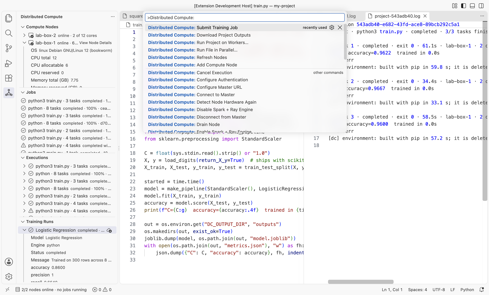

| Area | Commands |
|---|---|
| Platform | Set Up Platform on This Computer, Stop Platform on This Computer, Connect to Master, Disconnect from Master, Configure Master URL, Configure Authentication, Show Connection Status, Show Cluster Status, Show Diagnostics |
| Workers | Add Compute Node, Test Node Connection, Detect Node Hardware Again, Configure Resource Slice, Set Environment Cache…, Rotate Node Key, Drain Node, Resume Node, Remove Node, Refresh Nodes |
| Runs | Run Project on Workers…, Download Project Outputs, Run Python File, Run File with Runtime…, Run File in Parallel…, View Execution Output, Cancel Execution, Retry Execution, Save Execution Results |
| Training | Submit Training Job, Train on This Dataset, Train with This Model File, New Custom Model File, Run Training Again, Enable / Disable Spark + Ray Engine |
| Project | Initialize Project, Validate Project Configuration (`distributed.json`) |

## Settings

| Setting | Default | What it does |
|---|---|---|
| `distributedCompute.masterUrl` | `http://localhost:8090` | The master to use. `https://` is required for anything not on this computer or your local network. |
| `distributedCompute.autoStartPlatform` | `true` | Once set up here, start the platform when VS Code opens. |
| `distributedCompute.autoConnect` | `false` | Connect to a remote master when VS Code opens (a local one connects anyway). |
| `distributedCompute.defaultRuntime` | `python` | Language used by **Run File** commands that do not ask. |
| `distributedCompute.defaultTimeoutSeconds` | `600` | Longest a task may run. |
| `distributedCompute.executionPolicy` | `safe_background` | Task priority on workers: `safe_background`, `balanced` or `max_available`. Never changes the slice. |
| `distributedCompute.training.defaultEngine` | `python` | Engine preselected for training. |
| `distributedCompute.training.defaultRounds` / `defaultEpochs` / `defaultLearningRate` | `3` / `10` / `0.01` | Training defaults. |
| `distributedCompute.refreshIntervalSeconds` | `15` | How often the views refresh. |
| `distributedCompute.showNotifications` | `true` | Notifications when runs are submitted. |
| `distributedCompute.platformPath` | (found automatically) | Folder of the platform's `docker-compose.yml`. Machine setting only. |
| `distributedCompute.logLevel` | `info` | Detail in **Show Diagnostics**. |

## Teams and remote masters

The platform can run on one shared machine for a whole team (see the
[deployment guide](https://github.com/lekshmipriya04/Distributed_Compute/blob/main/distributed-ai-platform/docs/DEPLOYMENT.md)).
Each person then:

1. runs **Configure Master URL** with the address they were given, e.g.
   `https://compute.example.org`;
2. runs **Configure Authentication** and pastes their personal token;
3. runs **Connect to Master**.

Everyone sees only their own workers, runs and models. The same account can
also use the web dashboard.

## Troubleshooting

| Problem | What to do |
|---|---|
| "Docker is needed" | Install Docker Desktop, open it once, then **Set Up Platform** again. |
| Docker "permission denied" (Linux) | `sudo usermod -aG docker $USER`, then log out and back in. |
| The first setup seems stuck | The first build takes several minutes. Progress is in **Show Diagnostics**. |
| "Could not reach host" when adding a worker | Check the address (not `localhost`), that the machine is on, and that SSH runs on that port. |
| "Wrong password" / password logins refused | Try again, or leave the password empty to get a command to install the key yourself. |
| A worker shows `unreachable` | **Test Node Connection**. If it moved to a new address, remove it and add it again. |
| A language is missing from the list | Install it on the worker, then **Detect Node Hardware Again**. |
| A project task fails with "[dc] Building the environment failed" | pip's message follows: fix the package name or version in `requirements.txt`. Packages that need a compiler need a worker that has one, or a version with ready-made wheels. |
| "python3 -m venv is not available on this worker" | On Debian/Ubuntu install `python3-venv` on the worker (or [uv](https://docs.astral.sh/uv/)). |
| "The folder holds more than 500 MB" | Upload large data as a dataset and list it in `project.datasets`; add big folders to `project.exclude`. |
| Anything else | **Show Diagnostics** shows what the extension did; include it (without passwords or tokens) in an [issue](https://github.com/lekshmipriya04/Distributed_Compute/issues). |

## Security and privacy

- **No telemetry.** The extension talks only to the master you configure.
- **Passwords are used once and never stored.** Workers get a restricted key
  that the platform removes when you remove the worker.
- **Tokens** are kept in VS Code's secret storage, never in settings or logs.
- **Restricted Mode.** In untrusted workspaces, a master URL or platform folder
  set by the workspace is ignored, and no `docker-compose.yml` from the
  workspace is run.
- Your code runs on your workers with the permissions of the account you
  added. Use a dedicated, non-admin account there.

## Develop

```bash
npm install
npm run compile      # typecheck + bundle
npm test             # unit tests
npm run test:vscode  # a real VS Code loads the extension
npm run package      # build the .vsix
```

Press F5 to start an Extension Development Host. End-to-end tests against the
real platform (`make up-dev`) are described in the repository's
[CONTRIBUTING.md](https://github.com/lekshmipriya04/Distributed_Compute/blob/main/CONTRIBUTING.md).
The screenshots above are taken by `npm run docs:screenshots`.

## Authors and license

Made by **AARON R**, **M R LEKSHMI PRIYA** and **ALEENA VJ**.
[MIT License](LICENSE). Release notes: [CHANGELOG.md](CHANGELOG.md).
